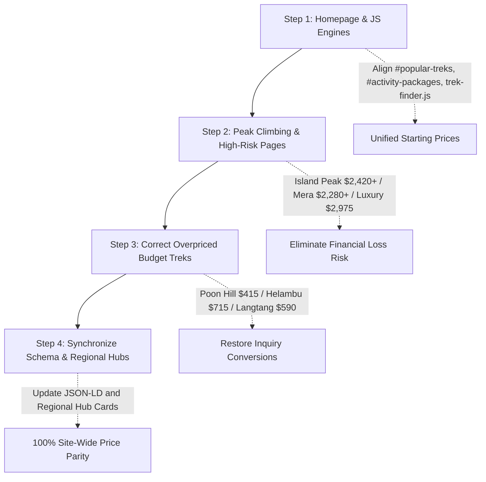

# Namaste Hiking Trek — Website Pricing Audit Report

> **Audit Source of Truth:**  
> Official Master Database: `Namaste Hiking Trek Profile info.xlsx` and `data/brand-profile.json`.  
> Scope: Live Homepage (`index.html`), Dynamic JS Engines (`js/activity-packages.js`, `js/trek-finder.js`), 39 Trek Pages (`trek/*/index.html`), 6 Tour Pages (`tour/*/index.html`), and 12 Regional Hubs.

---

## Executive Summary & Critical Findings

Our audit compared every price currently published across the website against the official pricing spreadsheet. We identified **four systemic pricing issues** across the site:

1. **The "Template Sidebar" Bug (Affecting 20+ Detail Pages)**:  
   A placeholder booking sidebar (`FROM $1,299`, departure table `$1,499`, group discount `$1,234 / $1,169 / $1,104`) was copy-pasted across dozens of trek detail pages.  
   * **Result:** Budget treks (Poon Hill, Helambu) appear **drastically overpriced** (3x higher than actual), while luxury/expedition treks (Kanchenjunga, EBC Luxury) appear **drastically underpriced**.
2. **Severe Underpricing on Peak Climbing Expeditions**:  
   All technical peaks (Mera Peak, Island Peak, Lobuche East, Pisang Peak) on the homepage and climbing pages are underpriced by **$400 to $650 per climber** compared to official spreadsheet rates.
3. **Internal Homepage Conflicts**:  
   The same package displays different prices in different sections of `index.html` (e.g., Manaslu Circuit is shown as **$1,250** in `#popular-treks` but **$1,399** in `#activity-packages`).
4. **Desynchronized JSON-LD Schema**:  
   In almost every trek page, the structured search engine schema (`"price": ...`) contradicts the visible price on the page.

---

## 1. Homepage & JavaScript Pricing Audit (`index.html`)

### A. Popular Treks & Activity Packages
| Package Title | Website Displayed Price | Official Spreadsheet Rate Matrix | Pricing Discrepancy & Analysis |
| :--- | :---: | :--- | :--- |
| **Everest Base Camp Trek** | **$1,399** | **1 Pax:** $1,740 • **2–4:** $1,485 • **5–8:** $1,435 • **9–12:** $1,385 • **13–18:** $1,345 | **$1,399 does not exist** in official tiers. Lowest group rate is $1,345; standard 2–4 pax rate is $1,485. |
| **Annapurna Base Camp Trek** | **$980** (Treks) **$1,150** (Activity) | **1 Pax:** $1,120 • **2–4:** $920 • **5–8:** $875 • **9–12:** $815 • **13–20:** $765 | **Internal conflict** ($980 vs $1,150). Official rate is $920 for small groups and $765 for groups. |
| **Manaslu Circuit Trek** | **$1,250** (Treks) **$1,399** (Activity) | **1 Pax:** $1,480 • **2–4:** $1,245 • **5–8:** $1,195 • **9–12:** $1,165 • **13–20:** $1,130 | **Internal conflict** ($1,250 vs $1,399). Official rate is $1,245 for 2–4 pax and $1,130 for groups. |
| **Mardi Himal Ridge Trek** | **$650** | **1 Pax:** $940 • **2–4:** $710 • **5–8:** $685 • **9–12:** $635 • **13–20:** $585 | **Mismatch.** Official starting price is $585 (large group) or $710 (standard 2–4 pax). |
| **EBC with Cho La Pass** | **$1,490** | **1 Pax:** $1,860 • **2–4:** $1,685 • **5–8:** $1,635 • **9–12:** $1,585 • **13–20:** $1,535 | **Underpriced by $45 to $195.** Lowest possible group tier in spreadsheet is $1,535. |
| **Langtang Valley Trek** | **$750** | **2–4 Pax:** $880 • **5–8:** $790 • **9–14:** $690 • **15–20:** $590 | **Mismatch.** Official 2–4 pax rate is $880; group rate is $590. |

---

### B. Peak Climbing Expeditions (`#peak-climbing` & `js/activity-packages.js`)
> [!WARNING]
> Peak climbing packages carry the largest financial exposure on the site. Publishing prices below the spreadsheet risks direct operating loss.

| Peak Expedition | Current Website Price | Official Spreadsheet Rate Matrix | Financial Discrepancy |
| :--- | :---: | :--- | :--- |
| **Island Peak with EBC (6,189m)** | **$1,850** (HTML) **$1,899** (JS) | **1 Pax:** $2,690 • **2–4:** $2,550 • **5–8:** $2,485 • **9–12:** $2,420 | **Underpriced by $570 to $840 per person!** The lowest group tier is $2,420. |
| **Mera Peak Climbing (6,476m)** | **$2,100** (HTML) **$1,999** (JS) | **1 Pax:** $2,775 • **2 Pax:** $2,550 • **3–6:** $2,475 • **7–10:** $2,415 • **16–20:** $2,280 | **Underpriced by $180 to $675 per person!** |
| **Lobuche East Peak (6,119m)** | **$1,980** (HTML) **$2,199** (JS) | **1 Pax:** $2,755 • **2–4:** $2,555 • **5–8:** $2,495 • **9–12:** $2,350 | **Underpriced by $370 to $775 per person!** |
| **Pisang Peak Climbing (6,091m)** | **$1,650** | **1–2 Pax:** $2,790 • **3–5:** $2,500 • **6–10:** $2,300 | **Underpriced by $650 to $1,140 per person!** |

---

### C. Day Hikes & Tours (`#tour-packages` & `js/activity-packages.js`)
| Tour Package | Website Price | Official Spreadsheet Rate | Note |
| :--- | :---: | :--- | :--- |
| **Kathmandu Heritage Tour** | **$450** (5 Days) | **$100 / person** (1-Day City Tour) | Website displays 5-day package; spreadsheet defines day tour rate. |
| **Chitwan Jungle Safari** | **$350** (3 Days) | **$90 / person** (1-Day Safari) | Website displays 3-day package; spreadsheet defines day tour rate. |
| **Nagarkot Sunrise Tour** | **$220** (3 Days) | **$250 / person** (6-Day Chisapani Nagarkot) | Duration and price mismatch. |
| **EBC Heli Flyover** | **$999** (1 Day) | **$1,700 / person** (EBC Heli Return) | Discrepancy between charter flyover and heli return package. |
| **ABC Heli Sightseeing** | **$749** (1 Day) | **$1,700 / person** (ABC Heli Return) | Discrepancy with official helicopter rates. |

---

## 2. Individual Trek Detail Pages (`trek/*/index.html`)

### The "Copy-Paste Template" Problem
Across **23 of the 39 trek pages**, the booking sidebar contains identical hardcoded placeholder numbers regardless of the actual trek:
- **Displayed Header:** `FROM $1,299 / person`
- **Departure Table:** `$1,499 pp`
- **Group Discount Accordion:**
  - 2 – 4 Persons: `$1,234 / person`
  - 5 – 8 Persons: `$1,169 / person`
  - 9+ Persons: `$1,104 / person`

### Business Impact by Category:

#### High Financial Risk: Treks Underpriced on Detail Pages
1. **Everest Base Camp Luxury Trek** (`trek/everest-base-camp-luxury-trek`):  
   - **Website Shows:** `$1,299` (Group discount down to `$1,104`)  
   - **Spreadsheet Official:** **$2,975 per person**  
   - **Loss Exposure:** **Over $1,700 per booking** if sold at the displayed price.
2. **Kanchenjunga Base Camp Trek** (`trek/kanchenjunga-base-camp-trek`):  
   - **Website Shows:** `$1,299` (Group discount down to `$1,104`)  
   - **Spreadsheet Official:** **$1,970 to $2,750 per person**  
   - **Loss Exposure:** **$866 to $1,450 per booking**.
3. **Everest Three Passes Trek** (`trek/everest-three-passes-trek`):  
   - **Website Shows:** `$1,299` (Group discount down to `$1,104`)  
   - **Spreadsheet Official:** **$2,075 per person**  
   - **Loss Exposure:** **$776 to $971 per booking**.
4. **Mera Peak Climbing** (`trek/mera-peak-climbing`):  
   - **Website Shows:** `$1,850`  
   - **Spreadsheet Official:** **$2,280 to $2,775 per person**  
   - **Loss Exposure:** **$430 to $925 per booking**.

#### High Conversion Risk: Treks Overpriced on Detail Pages
1. **Ghorepani Poon Hill Trek** (`trek/ghorepani-poon-hill-trek`):  
   - **Website Shows:** `$1,299` (Departure table `$1,499`)  
   - **Spreadsheet Official:** **$415 to $510 per person**  
   - **Impact:** Trekkers looking for a short 5-day budget trek see $1,299–$1,499 and immediately bounce to competitors.
2. **Helambu Trek** (`trek/helambu-trek`):  
   - **Website Shows:** `$1,299`  
   - **Spreadsheet Official:** **$715 per person**  
   - **Impact:** Almost double the actual price.
3. **Tamang Heritage Trail** (`trek/tamang-heritage-trail-trek`):  
   - **Website Shows:** `$1,299`  
   - **Spreadsheet Official:** **$875 per person**  
   - **Impact:** Substantially overpriced.
4. **Langtang Valley Trek** (`trek/langtang-valley-trek`):  
   - **Website Shows:** `$1,299`  
   - **Spreadsheet Official:** **$590 to $880 per person**  
   - **Impact:** Overpriced by $400 to $700.

---

## 3. Interactive JavaScript Engine Audits

### `js/trek-finder.js` (`sampleTreks` array)
| ID / Slug | Published `basePriceUSD` | Spreadsheet Official Tier Range | Correction Needed |
| :--- | :---: | :---: | :--- |
| `dhaulagiri-circuit-trek` | **$1,999** | $1,950 – $2,495 | Set to **$1,999** (matches 2–4 pax tier). |
| `pikey-peak-trek` | **$890** | $700 – $825 | Set to **$750** (or $800). |
| `everest-base-camp-trek` | **$1,399** | $1,345 – $1,740 | Set to **$1,345** (or $1,485). |
| `annapurna-base-camp-trek` | **$980** | $765 – $1,120 | Set to **$765** (or $920). |
| `manaslu-circuit-trek` | **$1,250** | $1,130 – $1,480 | Set to **$1,130** (or $1,245). |
| `mardi-himal-trek` | **$650** | $585 – $940 | Set to **$585** (or $710). |
| `gokyo-lakes-and-cho-la-pass`| **$1,490** | $1,535 – $1,860 | Set to **$1,535** (or $1,685). |
| `langtang-gosaikunda-trek` | **$890** | $705 – $1,070 | Set to **$755** (or $855). |
| `langtang-valley-trek` | **$750** | $590 – $880 | Set to **$590** (or $880). |

---

## 4. Regional Hub Hubs (`*-region-treks/index.html`)

The regional hub cards currently display mixed prices that do not match the spreadsheet or the homepage:
- **Everest Hub (`everest-region-treks/index.html`):**  
  Three High Passes Trek is listed as **$1,650** (Spreadsheet official: **$2,075**).
- **Annapurna Hub (`annapurna-region-treks/index.html`):**  
  Annapurna Base Camp is listed as **$890** (Spreadsheet official: **$920** for 2–4 pax, **$765** for groups).  
  Annapurna Circuit is listed as **$1,090** (Spreadsheet official: **$1,160** minimum group tier).
- **Peak Climbing Hub (`peak-climbing-nepal/index.html`):**  
  Island Peak is listed as **$2,190** (Spreadsheet: **$2,420 – $2,690**).  
  Mera Peak is listed as **$1,850** (Spreadsheet: **$2,280 – $2,775**).

---

## 5. Strategic Recommendations & Remediation Plan

### Recommendation 1: Adopt a Consistent "Starting From" Rule
For tiered packages, choose either:
- **Strategy A (Competitive / Best Deal):** Display the lowest group rate with "From $X" (e.g., EBC *"From $1,345"*, ABC *"From $765"*).
- **Strategy B (Standard 2–4 Pax):** Display the standard 2–4 person rate with "From $X" (e.g., EBC *"From $1,485"*, ABC *"From $920"*).  
*Whichever strategy is chosen must be applied consistently across the entire site.*

### Recommendation 2: Immediate Fix for High-Risk Peak Expeditions
Update Island Peak, Mera Peak, Lobuche East, and Pisang Peak immediately so that no climber can book below the official NMA/permit-covered cost.

### Recommendation 3: Replace the Copied Sidebar on Budget Treks
Update `ghorepani-poon-hill-trek`, `helambu-trek`, `tamang-heritage-trail-trek`, and `langtang-valley-trek` sidebars with their true spreadsheet rates to unblock traveler bookings.
